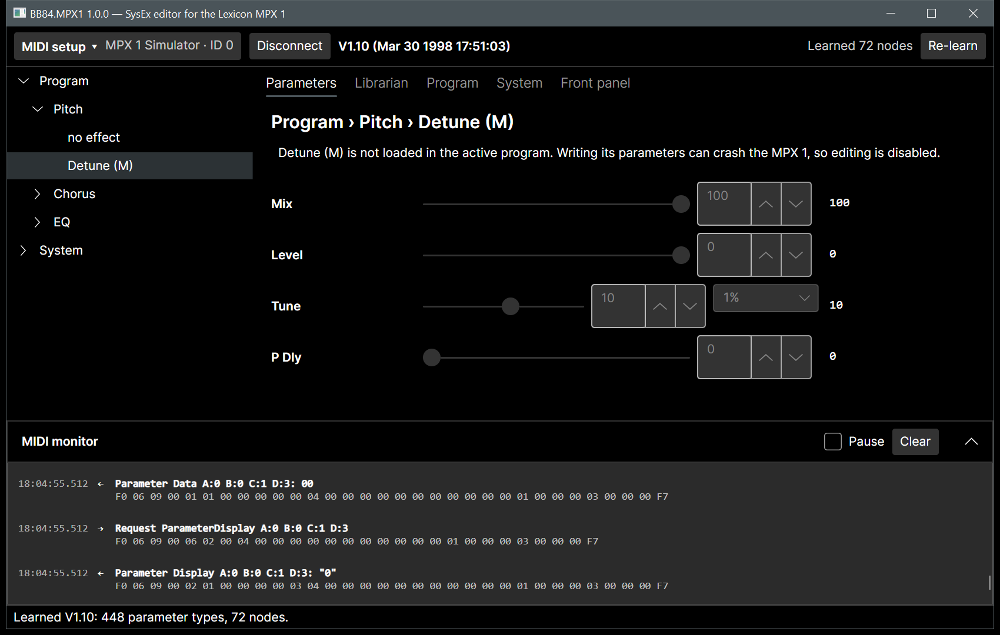
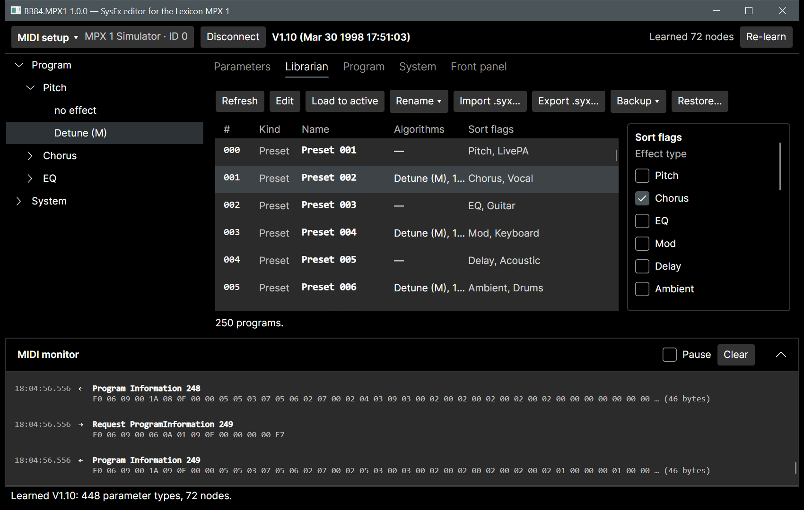
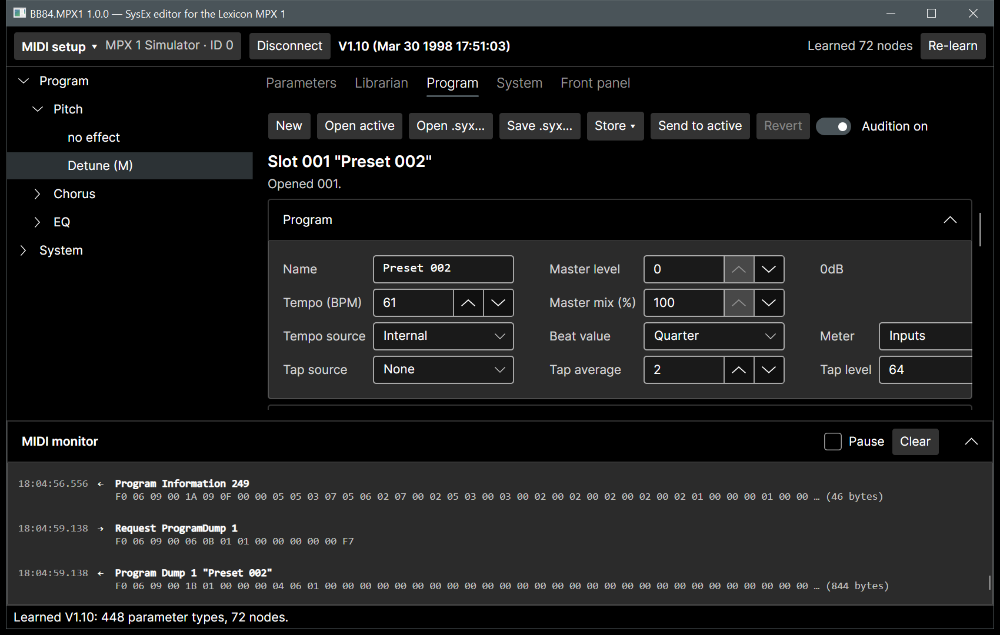
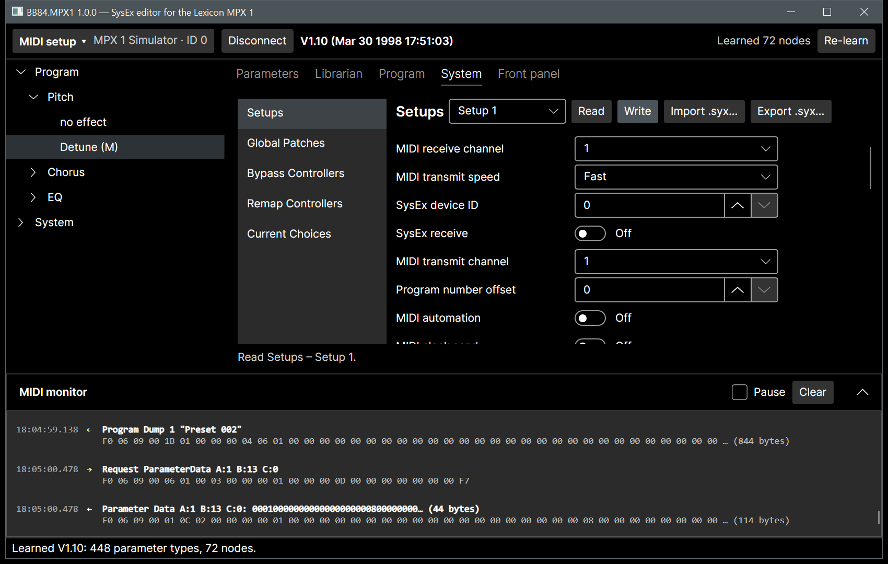
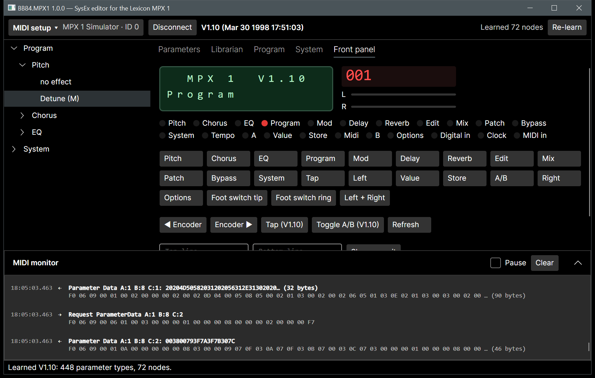

# BB84.MPX1

A SysEx editor and librarian for the **Lexicon MPX 1** multi-effects processor (firmware V1.00 and V1.10). It replaces the 1998 16-bit editor, which no longer runs on 64-bit Windows.

BB84.MPX1 is a clean-room implementation, written from Lexicon's published MIDI Implementation document only. It is a single native Windows x64 executable (.NET 10 Native AOT, Avalonia UI), and you don't need to install .NET.



## Features

- **Learns your unit.** The editor reads the parameter descriptions, control tree and algorithm parameter lists from the MPX 1 and caches them per firmware build. Both V1.00 and V1.10 work without built-in version tables.
- **Live parameter editing.** Browse the control tree and edit values with editors that match each parameter (slider, list, switch, text, Rate in Hz or tempo ratio). Changes reach the unit as you drag. The unit's own display text is read back after each change.
- **Librarian.** View all 250 programs with names, algorithms and sort flags. Load, rename, edit sort flags, import and export `.syx` files, and make full backups and restores, including Setups, Global Patches, Bypass and Remap Controllers.
- **Program editor.** Edit every part of a program:
  - the six effect blocks and their algorithms
  - audio routing on a signal-flow map, offering only the routings the unit allows
  - soft row and patches
  - tempo, tap, meter, master level and mix, and the knob
  - all modulators (LFOs, ADSRs, arpeggiator, random, A/B, sample and hold, envelopes)

  You hear each change on the active program as you edit; it is stored only when you choose Store. Program files can also be edited offline.

- **System dumps.** Typed editors for the five stored setups and the active one, Global Patches, Bypass and Remap Controllers, plus the read-only Current Choices.
- **Virtual front panel.** The 2×16 display (with custom characters), LEDs, headroom bars and digits are mirrored live. You can press, hold and combine the panel buttons, and turn the encoder.
- **MIDI monitor.** Every frame is shown as hex with a decoded summary.
- **Built-in simulator.** Try everything without hardware: choose "MPX 1 Simulator" as the MIDI port.
- **Safe by default.** Overwriting factory presets, restoring backups and writing setups always ask first. Parameters of algorithms that are not loaded are never written, because doing so can crash the unit (Appendix D of the MIDI document).

| Librarian                               | Program editor                             |
| --------------------------------------- | ------------------------------------------ |
|  |  |

| System dumps                            | Front panel                                 |
| --------------------------------------- | ------------------------------------------- |
|  |  |

## Getting started

1. Download `BB84.MPX1-<version>-win-x64.zip` from the releases page and extract it anywhere.
2. Start `BB84.MPX1.exe`.
3. Open **MIDI setup**, choose the MIDI input and output connected to the MPX 1, and set the **Device ID** to the unit's Receive Device ID (System > MIDI > SysEx, then Options). Choose **Connect**.
4. The first time you connect a given firmware build, choose **Learn**. Learning takes a short while; the result is cached, so later connections are immediate.

To try the editor without a unit, select **MPX 1 Simulator** as the input and output.

### MIDI setup tips

- Connect the MPX 1 MIDI OUT to your interface's IN, and the interface's OUT to the MPX 1 MIDI IN. SysEx reception must be on (System > MIDI > SysEx = On on the unit).
- If you see timeouts, check the device ID, then raise **Timeout** or set a **Frame gap** of a few milliseconds for slow interfaces.
- **Test connection** sends ARE_YOU_THERE and reports whether the unit answered.

Settings are stored in `%APPDATA%\BB84.MPX1\settings.json`. Learned databases are cached in `%LOCALAPPDATA%\BB84.MPX1\databases`.

## Building from source

Requires the .NET 10 SDK. Native AOT publishing also needs the Visual Studio C++ build tools.

```powershell
dotnet build BB84.MPX1.slnx -c Release
dotnet test --solution BB84.MPX1.slnx -c Release -- --ignore-exit-code 8 --filter "TestCategory!=Hardware"
dotnet publish src/BB84.MPX1.App -c Release -r win-x64 -o artifacts/publish
```

The architecture, protocol details and requirements are in [the specification](spec/spec-architecture-mpx1-sysex-editor.md). Delivery milestones are in [the roadmap](docs/roadmap.md).

## Status

Version 1.0.0-Alpha was verified against the built-in simulator only. Validation on real hardware is planned (roadmap M8). If you own an MPX 1 and can test, reports are welcome.

## Legal

BB84.MPX1 is licensed under the [MIT License](LICENSE).

"Lexicon" and "MPX 1" are trademarks of their respective owner and are used here only to describe the device this software works with. This project is not affiliated with or endorsed by Lexicon or Harman. No code, text or artwork from the original WazWare editor is used.
