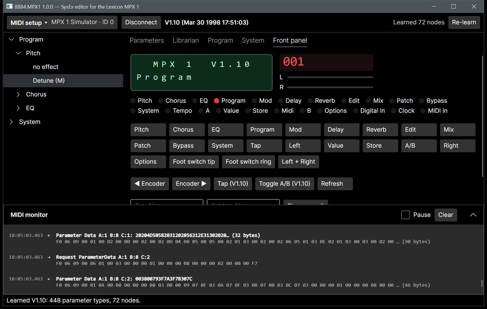

# BB84.MPX1


A SysEx editor and librarian for the **Lexicon MPX 1** multi-effects processor (firmware V1.00 and V1.10). It replaces the 1998 16-bit editor, which no longer runs on 64-bit Windows.

BB84.MPX1 is a clean-room implementation, written from Lexicon's published MIDI Implementation document only. It is a single native Windows x64 executable (.NET 10 Native AOT, Avalonia UI), and you don't need to install .NET.


## Features

- **Learns your unit.** The editor reads the parameter descriptions, control tree and algorithm parameter lists from the MPX 1 and caches them per firmware build. Both V1.00 and V1.10 work without built-in version tables.
- **Live parameter editing.** Browse the control tree and edit values with editors that match each parameter (slider, list, switch, text, Rate in Hz or tempo ratio). Changes reach the unit as you drag. The unit's own display text is read back after each change.
- **Librarian.** View all 250 programs with names, algorithms and sort flags. Load, rename, edit sort flags, import and export `.syx` files, and make full backups and restores, including Setups, Global Patches, Bypass and Remap Controllers.
- **Program editor.** Edit every part of a program:
  - the six effect blocks and their algorithms
  - audio routing on a signal-flow map, offering only the routings the unit allows
  - soft row and patches
  - tempo, tap, meter, master level and mix, and the knob
  - all modulators (LFOs, ADSRs, arpeggiator, random, A/B, sample and hold, envelopes)

  You hear each change on the active program as you edit; it is stored only when you choose Store. Program files can also be edited offline.

- **System dumps.** Typed editors for the five stored setups and the active one, Global Patches, Bypass and Remap Controllers, plus the read-only Current Choices.
- **Virtual front panel.** The 2×16 display (with custom characters), LEDs, headroom bars and digits are mirrored live. You can press, hold and combine the panel buttons, and turn the encoder.
- **MIDI monitor.** Every frame is shown as hex with a decoded summary.
- **Built-in simulator.** Try everything without hardware: choose "MPX 1 Simulator" as the MIDI port.
- **Safe by default.** Overwriting factory presets, restoring backups and writing setups always ask first. Parameters of algorithms that are not loaded are never written, because doing so can crash the unit (Appendix D of the MIDI document).

| Librarian                               | Program editor                             |
| --------------------------------------- | ------------------------------------------ |
|  |  |

| System dumps                            | Front panel                                 |
| --------------------------------------- | ------------------------------------------- |
|  |  |

## Getting started

1. Download the build for your system from the releases page:
   - Windows: `BB84.MPX1-<version>-win-x64.zip`. Extract it anywhere and start `BB84.MPX1.exe`.
   - Linux (x64), either of these. See [Linux](#linux) below.
     - `BB84.MPX1-<version>-x86_64.AppImage`. Make it executable (`chmod +x BB84.MPX1-*.AppImage`) and start it.
     - `BB84.MPX1-<version>-x86_64.flatpak`, a sandboxed package. Install it with `flatpak install --user BB84.MPX1-<version>-x86_64.flatpak` and start it from the app menu or with `flatpak run io.github.BoBoBaSs84.BB84.MPX1`. Flatpak fetches the freedesktop runtime from Flathub during the install.
2. Neither build needs .NET installed. Each `.sha256` file holds the checksum of its download.
3. Open **MIDI setup**, choose the MIDI input and output connected to the MPX 1, and set the **Device ID** to the unit's Receive Device ID (System > MIDI > SysEx, then Options). Choose **Connect**.
4. The first time you connect a given firmware build, choose **Learn**. Learning takes a short while; the result is cached, so later connections are immediate.

To try the editor without a unit, select **MPX 1 Simulator** as the input and output.

### Linux

The AppImage needs:

- `fusermount` to mount itself (package `fuse3` or `fuse`). Without it, run it with `--appimage-extract-and-run`.
- `libasound2` (on newer Ubuntu and Debian `libasound2t64`) for MIDI. It is not bundled, because it must match the system's ALSA setup.
- Access to the ALSA sequencer device `/dev/snd/seq`. On most distributions this means membership in the `audio` group: `sudo usermod -aG audio $USER`, then log out and in again.

The Flatpak brings its own `libasound2` and needs only the sequencer access. Its sandbox allows the X11 display (XWayland on Wayland desktops) and device access for MIDI, and nothing else. It has no network access, and it opens and saves `.syx` files through the system file dialog (the file chooser portal). Its settings and learned databases live in `~/.var/app/io.github.BoBoBaSs84.BB84.MPX1/`.

MIDI ports are listed as `client:port`, for example `UM-ONE:UM-ONE MIDI 1`. Without a sequencer the app offers only the simulator.

### MIDI setup tips

- Connect the MPX 1 MIDI OUT to your interface's IN, and the interface's OUT to the MPX 1 MIDI IN. SysEx reception must be on (System > MIDI > SysEx = On on the unit).
- The MPX 1 MIDI IN is the 7-pin DIN jack labelled **Remote/In**; it takes a normal 5-pin MIDI plug. Do not use **Thru**: the unit then hears nothing. On cable interfaces such as the USB Uno, the plug marked "To MIDI In" goes into the unit's IN.
- If the unit answers nothing at all, the device ID may be wrong: the hardware test `DeviceInquiry_Broadcast_IsAnswered` (below) reports the ID the unit answers with.
- If you see timeouts, check the device ID, then raise **Timeout** or set a **Frame gap** of a few milliseconds for slow interfaces.
- **Test connection** sends ARE_YOU_THERE and reports whether the unit answered.

Settings are stored in `%APPDATA%\BB84.MPX1\settings.json`. Learned databases are cached in `%LOCALAPPDATA%\BB84.MPX1\databases`. On Linux these are `$XDG_CONFIG_HOME/BB84.MPX1/settings.json` (default `~/.config`) and `$XDG_DATA_HOME/BB84.MPX1/databases` (default `~/.local/share`).

## Building from source

Requires the .NET 10 SDK. Native AOT publishing also needs the Visual Studio C++ build tools on Windows, or `clang` and `zlib1g-dev` on Linux.

```powershell
dotnet build BB84.MPX1.slnx -c Release
dotnet test --solution BB84.MPX1.slnx -c Release -- --ignore-exit-code 8 --filter "TestCategory!=Hardware"
dotnet publish src/BB84.MPX1.App -c Release -r win-x64 -o artifacts/publish
```

The solution also builds and its tests pass on Linux. There the app talks to MIDI ports through the ALSA sequencer. It needs `libasound2` and access to `/dev/snd/seq` (usually membership in the `audio` group). Ports are listed as `client:port`, for example `UM-ONE:UM-ONE MIDI 1`. Without a sequencer the app offers only the simulator. The WinMM tests skip themselves on Linux. The ALSA loopback tests (category `Alsa`) use the kernel's `Midi Through` port (`sudo modprobe snd-seq-dummy`), and report as inconclusive without it. To package a release, run `./build/package.ps1 -Version <version> -Runtime win-x64` for the Windows zip, or `-Runtime linux-x64` on Linux for the AppImage and the Flatpak bundle. The Linux package also needs `flatpak` and `flatpak-builder` with the Flathub remote (`flatpak remote-add --user --if-not-exists flathub https://dl.flathub.org/repo/flathub.flatpakrepo`). The desktop file, AppStream metainfo, icon and Flatpak manifest are in `packaging/linux`.

### Unit tests and loopMIDI

Most tests run against the built-in simulator and need no MIDI hardware. The WinMM transport tests (`tests/BB84.MPX1.Midi.WinMM.Tests`, category `LoopMidi`) also exercise the real Windows MIDI path. They need a virtual loopback port:

1. Install [loopMIDI](https://www.tobias-erichsen.de/software/loopmidi.html).
2. Create three ports with exactly these names, and keep loopMIDI running while you test:
   - `loopMIDI Port` (the default name): whatever is sent to it comes back on its input. The transport tests use it as a plain echo.
   - `loopMIDI Port Editor` and `loopMIDI Port Simulator`: the editor reads `Editor` and writes `Simulator`, and the built-in simulator does the reverse. These tests run the session, the learner and the librarian against the simulator with every frame crossing the real WinMM transport.

Without the ports, these tests report as inconclusive (skipped) instead of failing, so machines without loopMIDI, and CI, still pass. The same happens when a freshly opened port pair delivers nothing in one direction, which loopMIDI does now and then. The test rig reopens the pair up to 16 times before it gives up. To run only these tests:

```powershell
dotnet test --project tests/BB84.MPX1.Midi.WinMM.Tests -c Release -- --filter "TestCategory=LoopMidi"
```

### Hardware tests

Tests in the `Hardware` category (`tests/BB84.MPX1.Midi.WinMM.Tests/Hardware`) run against a real MPX 1 and are excluded from the default run. Without configuration they report as skipped. Set the ports and device ID, then run them:

```powershell
$env:MPX1_MIDI_IN = 'USB Uno MIDI Interface'; $env:MPX1_MIDI_OUT = 'USB Uno MIDI Interface'; $env:MPX1_DEVICE_ID = '3'
dotnet test --project tests/BB84.MPX1.Midi.WinMM.Tests -c Release -- --filter "TestCategory=Hardware"
```

They check inquiry, firmware, ARE_YOU_THERE, a full learn, program reads, a full backup and an empty program. Two tests write to the unit. Each saves the affected data to `artifacts/hardware/backups` first and puts it back afterwards:

- `WriteSlot_RoundTripsAndRestores` writes, reads back and restores one user program: `MPX1_WRITE_SLOT`, protocol number, default 214 (front panel 215). Pick a program you have backed up; empty ("available") programs cannot be used.
- `SystemDumps_WriteBackUnchanged` writes the setups, Global Patches, Bypass and Remap dumps back unchanged. The unit applies the active setup at once, with the same values.

Optional: `MPX1_READ_SLOT`/`MPX1_READ_NAME` (a program and its expected name), `MPX1_EMPTY_SLOT` (an empty user program). Every run records its MIDI traffic to `artifacts/hardware/<test>.jsonl` and its messages to `<test>.log`. Recordings of a V1.00 unit are kept in `tests/data/hardware/v100` and replayed by `HardwareReplayTests` in the default run.

The architecture, protocol details and requirements are in [the specification](spec/spec-architecture-mpx1-sysex-editor.md). Delivery milestones are in [the roadmap](docs/roadmap.md).

## Status

Validated on a real MPX 1 with firmware V1.00 (roadmap M8): learn, program read and write, full backup, and system dump write-back. V1.10 has been tested against the simulator only. If you own a V1.10 unit and can test, reports are welcome.

## Legal

BB84.MPX1 is licensed under the [MIT License](LICENSE).

"Lexicon" and "MPX 1" are trademarks of their respective owner and are used here only to describe the device this software works with. This project is not affiliated with or endorsed by Lexicon or Harman. No code, text or artwork from the original WazWare editor is used.
